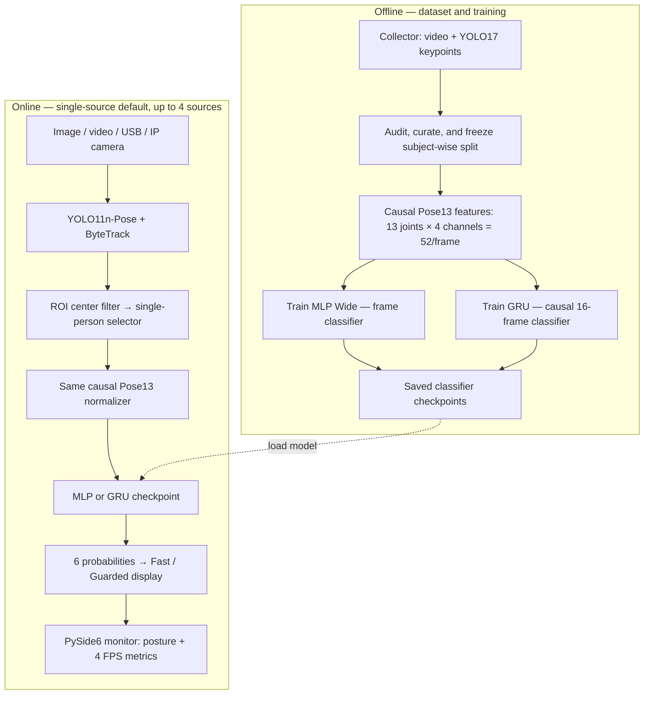
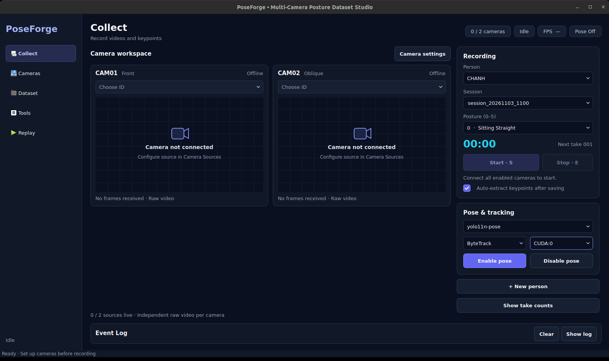
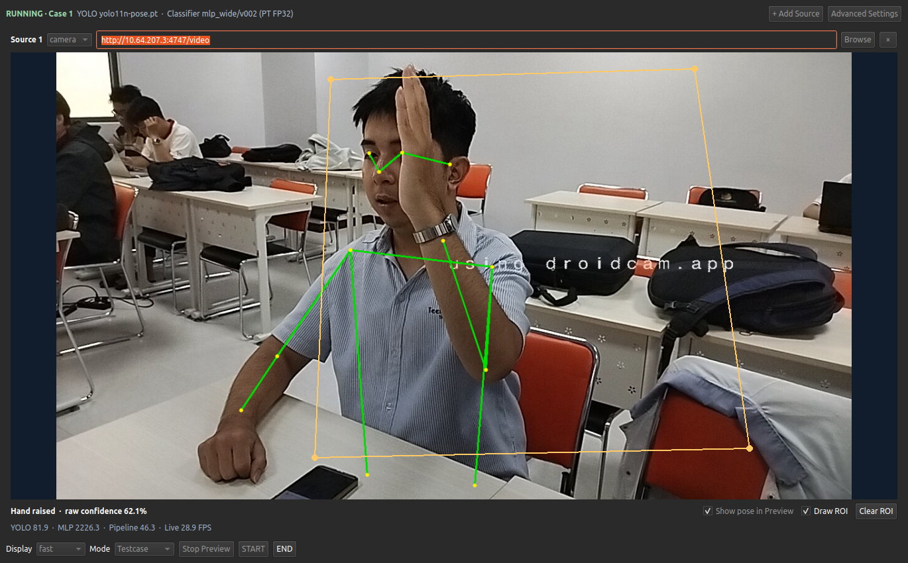
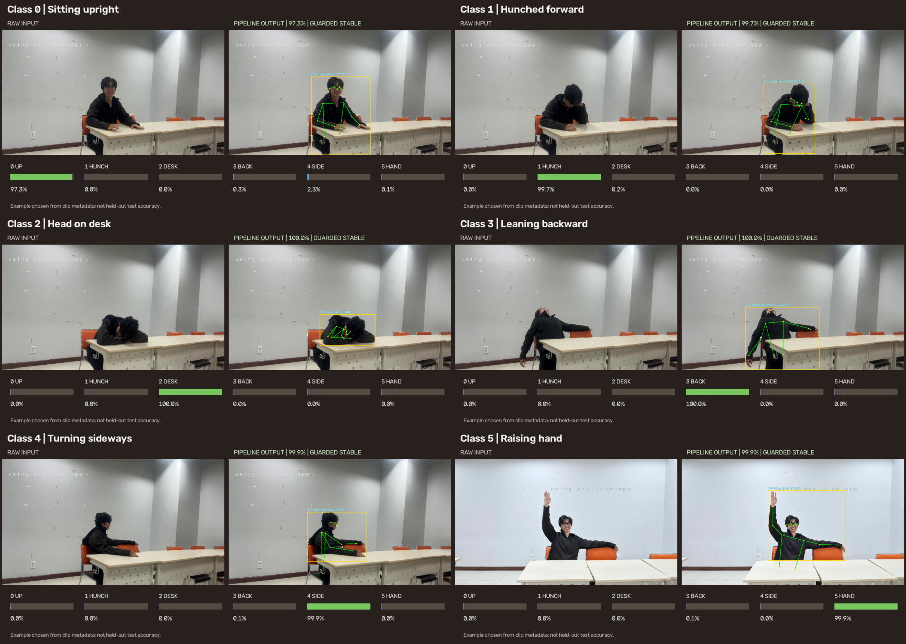

# PoseForge — Classroom Sitting Posture Recognition

**Offline posture recognition from RGB images, recorded video, or live cameras.** PoseForge extracts human skeleton keypoints using pretrained **Ultralytics YOLO11n-Pose** and trains its own six-class posture classifier. The project provides a separate data collector, reproducible training notebooks, a PySide6 inference monitor, and performance benchmarks.

**Platform:** Python 3.11 · Ubuntu 22.04 · PyTorch · OpenCV · Ultralytics · PySide6 · Conda.
**Maintainer:** Duong Thien Truong · [Runbook](docs/RUN.md) · [License](LICENSE) · [Third-party notices](THIRD_PARTY_NOTICES.md)

## Task and labels

| ID | Posture | ID | Posture |
|---:|---|---:|---|
| 0 | Sitting upright | 3 | Leaning backward |
| 1 | Hunched forward | 4 | Turning sideways |
| 2 | Head on desk | 5 | Raising a hand |

## Architecture



The 52-channel vector is `13 joints × (normalized x, normalized y, confidence, valid mask)`. Missing/occluded points retain a validity mask; normalization uses only current/past observations. GRU keeps its own history per source and resets it at case/track boundaries. **MLP Wide is the default classifier.** Pose detection and tracking are pretrained; posture classifiers are trained by this project.

## Results

**Frozen person-wise train/validation/test split:** 14 participants, 206 camera clips and 21,996 recorded frames; 11 train, 2 validation, **1 held-out test participant**, with six classes and two camera angles. The numbers below are from the same 841-frame held-out test set, not from the diagnostic recording-label agreement check.

| Metric | MLP Wide (52 → 256 → 128 → 6) | GRU (2 layers, hidden 64, 16 frames) |
|---|---:|---:|
| Trainable parameters | 47,238 | 48,006 |
| Held-out test accuracy | **99.17%** | 81.33% |
| Held-out test Macro-F1 | **99.18%** | 81.27% |
| Pipeline throughput | **145.63 FPS** | 143.73 FPS |

**FPS protocol:** NVIDIA GPU, YOLO11n-Pose PT + classifier PT FP32, overlay on, 720 frames × 3 rounds, GPU for both stages. This is **headless pipeline throughput**, excluding capture/video decode and Qt rendering; it is not a guaranteed live camera/UI frame rate. Model-level YOLO and classifier FPS are different measurements and must not be added together. Test results represent one held-out person and are not a multi-person deployment guarantee.

## Quick start

```bash
# From the repository root. Requires Conda and the pretrained/trained weights.
bash scripts/setup_ubuntu.sh --pose
conda activate lab2_imp
python -B scripts/prepare_yolo_pose.py --variants n

# Inference UI: YOLO and MLP both on GPU 0; PT FP32
python -m inference.gui --device 0 --cls-device cuda:0

# Collector UI (separate application)
bash scripts/run_collector.sh --data artifacts/collector_runtime/Real_Posture_Dataset
```

Classifier checkpoint directories are local and not stored in Git (e.g. `artifacts/models/mlp_wide/v002/` and `artifacts/models/gru_temporal/v001/`). Install your **own trained** checkpoint bundle using `bash scripts/install_trained_model.sh /path/to/bundle.zip`. In **Advanced Settings**, select the YOLO Pose `.pt` file and the classifier **folder** containing `model_final.pt`. Switch to GRU there when needed; the MLP remains the default. When CUDA is unavailable, use `--device cpu --cls-device cpu`.

### Inference controls

- **Preview Sources** previews raw inputs; **Show pose in Preview** draws YOLO detections only, not classifier output.
- **Draw ROI:** click at least three polygon points. Filtering is active during **START** inference; it checks each detected person's **bbox center after YOLO**, not a cropped image. Raw pose preview may still show detections outside the ROI. **Clear ROI** removes it.
- **Fast / Guarded:** immediate class prediction / stable decision after consecutive frames. **Testcase:** START processes continuously until END resets that case; START begins the next. **Continuous:** END stops the session.
- **YOLO / MLP-or-GRU / Pipeline / Live FPS** are separate counters. UI render FPS controls painting frequency, not model throughput. The GUI does **not** auto-save annotated media; use the inference CLI for saved outputs.

## Dataset format and notebooks

The original dataset is **private and not included in this repository**. An abbreviated example of the collector's layout:

```text
Real_Posture_Dataset/
├── labels.csv                  # clip_id, take_id, person_id, camera_view, label, ...
├── config/                     # label/camera configuration
└── recordings/<person>/<session>/label_<0..5>/take_<NNN>/
    ├── metadata.json
    ├── cam01_raw.mp4            # front view (private)
    ├── cam02_raw.mp4            # oblique view (private)
    └── keypoints/
        └── cam01_yolo17_raw.txt # one JSON observation per line
```

Train and test subjects **must not overlap**. Raw recordings and personally identifying metadata must not be uploaded publicly. Notebook 02 exports a processed `pose13_features.zip` containing per-clip pose features and frozen split metadata.

| Order | Colab notebook | Purpose | Required input |
|---:|---|---|---|
| 1 | `notebooks/01_raw_eda_split_v2.ipynb` | Raw audit, EDA, fixed person split | Curated clean RAW ZIP |
| 2 | `notebooks/02_process_eda_export_v2.ipynb` | Causal 17 → 13 keypoint processing; export | Same clean RAW ZIP |
| 3 | `notebooks/03_train_mlp_v2.ipynb` | MLP sweep, validation selection, final test | RAW ZIP for provenance **and** processed ZIP |
| 4 | `notebooks/04_train_gru_v2.ipynb` | GRU training and comparison, without changing the MLP | Processed ZIP |

Upload the clean RAW ZIP and `shared/` modules to the Drive project root, then set `POSEFORGE_ROOT`, `POSEFORGE_ZIP` and (for training) `POSEFORGE_PROCESSED_ZIP` in the Colab environment or notebook config. The processed ZIP can be reused for GRU without rerunning pose extraction. The student-submission notebook and personal report are intentionally not part of the public GitHub release.

## Commands for reproducibility

```bash
# CLI image/video inference; output under artifacts/inference/ with a fresh run folder
python -m inference.run --source /path/to/video.mp4 --mode video \
  --pose artifacts/pretrained/yolo11n-pose.pt \
  --model artifacts/models/mlp_wide/v002 \
  --device 0 --cls-device cuda:0 --backend pt --headless

# Same workload for MLP or GRU: change only --classifier
python -B scripts/benchmark_inference_pipeline.py \
  --data artifacts/dataset_working/Real_Posture_Dataset \
  --pose artifacts/pretrained/yolo11n-pose.pt \
  --classifier artifacts/models/mlp_wide/v002 \
  --cls-backend pt --device 0 --cls-device cuda:0 \
  --frames 720 --warmup 20 --rounds 3 --seed 302 --overlay on

# Validation, collector and inference regression tests
bash scripts/test.sh full
bash scripts/test.sh ui
```

Collector data export, ONNX export, source options, detailed flags, and troubleshooting are in **[docs/RUN.md](docs/RUN.md)**.

## Screenshots

**Collector** (live capture, labels and source management):



**Inference monitor** (source preview, ROI, model selection and FPS):



**Six-class posture predictions** (TRUONG; pose skeleton and class labels):




## Privacy, license, and attribution

- PoseForge source code: **AGPL-3.0-only**; see [LICENSE](LICENSE) and [THIRD_PARTY_NOTICES.md](THIRD_PARTY_NOTICES.md). Ultralytics YOLO11 weights/code and PySide6 have their **own** licensing conditions; a PoseForge license does not grant rights over third-party weights.
- All inference is local/offline after obtaining model weights and installing dependencies. Do not infer student attentiveness or make disciplinary decisions solely from posture predictions. The project is a research/education prototype, not a surveillance deployment product.
